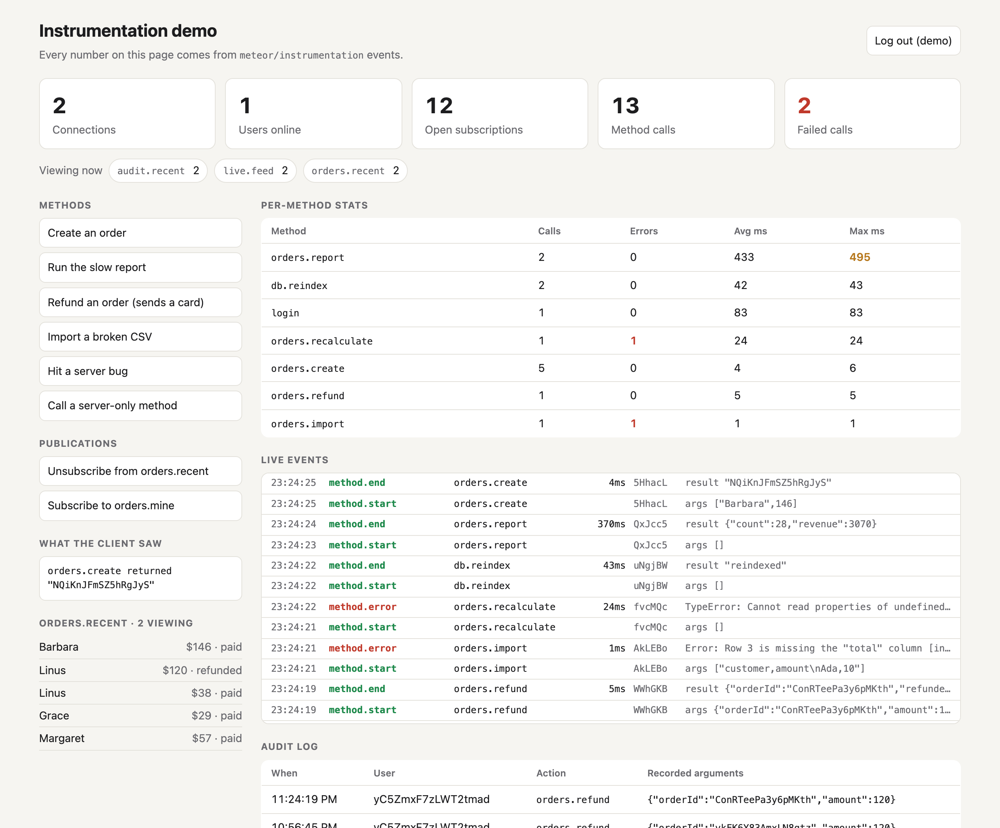
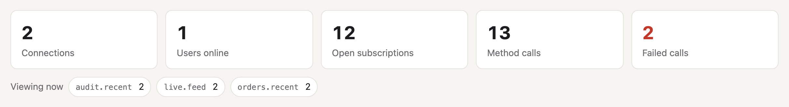
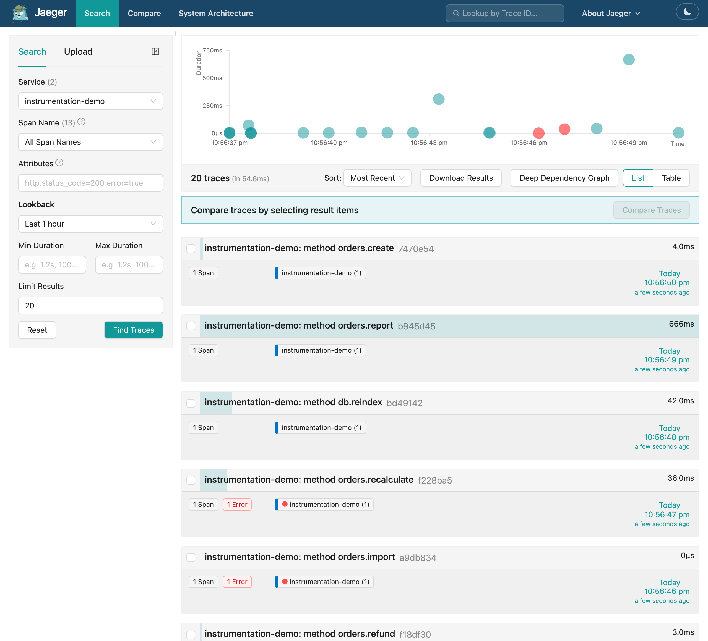

# How to see what your Meteor server is doing

How long does `orders.create` take? Which publication is failing? How many clients are connected?

In version 3.6, Meteor ships a package that can help you answer those questions. With `instrumentation`, you can check every method call, every publication, and every DDP connection.

Before having this package to get those numbers, we had to wrap Meteor's internals. It was common to see patched method handlers and DDP sessions, and each one had to keep up with core changes on its own.

In this blog, we will build a small app to test it out. We will start with a slow report, a method that has a bug, and a refund that takes a card number, and then export this information to OpenTelemetry(this last one I learned with @dupontbertrand in this [document](https://github.com/meteor/meteor/blob/release-3.6/v3-docs/docs/api/instrumentation.md) 😄)

The app code is on [GitHub](https://github.com/Grubba27/instrumentation-demo).

To get started:

```bash
meteor add instrumentation
```

> The package runs only on the server.

Register your listeners once, in code that runs at startup:

```ts
import { Instrumentation } from 'meteor/instrumentation';

Instrumentation.on('method.end', (event) => {
  console.log(`${event.name} took ${event.durationMs}ms`);
});
```

Nine events cover the life of a method, a publication, and a connection:

| What | Events |
| --- | --- |
| Methods | `method.start`, `method.end`, `method.error` |
| Publications | `publication.start`, `publication.ready`, `publication.stop`, `publication.error` |
| Connections | `ddp.connection.open`, `ddp.connection.close` |

A method or publication event tells you what ran and for whom: its `name`, the `userId`, the `connectionId`, and a `traceId` that the start shares with the end.

> A listener can watch a call but cannot change it.  You can only do side effects.

Meteor does not wait for a listener, and when it throws, the call continues on. If your listener may error, you can catch the error like this:

```ts
Instrumentation.configure({
  onListenerError: (error, event) => {
    console.error(`listener failed on ${event.type}:`, error);
  },
});
```

The events are typed. In an app that uses the native types. A misspelled event name fails the type-checker, and `event.error` exists only on the events that have one.

With that detail noted, we can get started with some fun:

## Find the slow methods

Two listeners are enough:

```ts
// server/observability/slow-methods.ts
const SLOW_MS = 200;

Instrumentation.on('method.end', (event) => {
  if (event.durationMs > SLOW_MS) {
    console.warn(`slow method: ${event.name} took ${event.durationMs}ms`);
  }
});

Instrumentation.on('method.error', (event) => {
  const { name, message } = event.error;
  console.error(`method failed: ${event.name} after ${event.durationMs}ms (${name}: ${message})`);
});
```

I ran the report, imported a broken CSV file, and called the method with the bug. The terminal showed:

```
slow method: orders.report took 722ms
method failed: orders.import after 2ms (Error: Row 3 is missing the "total" column [invalid-csv])
method failed: orders.recalculate after 39ms (TypeError: Cannot read properties of undefined (reading 'total'))
```

`orders.import` throws a `Meteor.Error`, the kind you throw on purpose so the client can see a message.

The third line is a real bug. The browser gets `Internal server error [500]` and no more. The listener gets the error name and message, plus the user, connection, and duration.

`event.error` is a summary, not the `Error` object: a name and a message, plus the `error` code and `reason` of a `Meteor.Error`. It has no stack trace.

Keep running totals in a `Map`, and the same two events become a table of every method: calls, errors, average time, and worst time. The demo does that in about 20 lines, with no outside service.



## Follow one call through your logs

A busy server will have a ton of log lines. To check one out, it is like finding a needle in a haystack, but we have a helper for those cases. To find which call wrote it, you can call `Instrumentation.currentContext()`; see it in action:

```ts
// server/observability/trace-log.ts
export function log(message: string, data: Record<string, unknown> = {}) {
  const { traceId, name } = Instrumentation.currentContext();
  console.log(JSON.stringify({ traceId, method: name, message, ...data }));
}
```

Inside a method or a publication, it returns the IDs of the call that is running. I called `log()` twice from `orders.create` and logged `method.end` from a listener. All three lines carry the same `traceId`:

```
{"traceId":"dkpePCgTd7thfAjix","method":"orders.create","message":"creating order","customer":"Margaret"}
{"traceId":"dkpePCgTd7thfAjix","method":"orders.create","message":"order created","orderId":"vH6cJh8jC2QTMGio3"}
{"traceId":"dkpePCgTd7thfAjix","method":"orders.create","message":"method.end","durationMs":16}
```

Search for that ID (your needle), and you get the whole story of one call.

A `traceId` names one invocation. If `orders.create` called a second method; that method would have received an ID of its own.

## Keep an audit trail without storing secrets

An event says how many arguments a method received, in `argsCount`, and nothing about what they were. To see arguments and results, you need to opt in:

```javascript
Instrumentation.configure({
  captureMethodArgs: 'preview',
  captureMethodResult: 'preview',
});
```

In this mode, you will see a preview(no pun intended) of your arguments, a trimmed copy of the real value: strings stop at 200 characters, objects and arrays at 32 entries, and nesting at 3 levels.

A preview of a card number is still a card number. In the demo, `orders.refund` receives an order ID, an amount, and a card. I want the first two in my audit log and the card nowhere:

```ts
// server/observability/audit.ts
Instrumentation.configureMethod<[string, number, Card]>('orders.refund', {
  captureArgs: ([orderId, amount]) => ({ orderId, amount }),
});

Instrumentation.on('method.end', async (event) => {
  if (event.name !== 'orders.refund') return;

  await AuditLog.insertAsync({
    at: new Date(event.ts),
    userId: event.userId,
    action: event.name,
    args: event.args,
    traceId: event.traceId,
    durationMs: event.durationMs,
  });
});
```

The function you pass to `configureMethod` receives a copy of the arguments and returns the part worth keeping. That part becomes `event.args`.

The browser sent a card number. The audit log stored this:

```javascript
{
  at: 2026-10-08T17:12:12.705Z,
  userId: 'yC5ZmxF7zLWT2tmad',
  action: 'orders.refund',
  args: { orderId: 'BDSPkvd559eBewywC', amount: 120 },
  traceId: 'QSdGuQExjMrdKCyvJ',
  durationMs: 4
}
```

Meteor's own Accounts methods need no configuration. With previews on for everything, the `login` event still arrived with `argsCount: 1` and no arguments or result. We take security very seriously here.

## Watch connections and subscriptions live

Sometimes you want to have a nice stat in your dashboard or just share around how many users are online or on the same page at a given time. With this feature, you can now have it.

```ts
// server/observability/presence.ts
// connectionId -> userId, null while the visitor is anonymous
const online = new Map<string, string | null>();
// publication name -> the subscriptions open on it right now
const viewers = new Map<string, Set<string>>();

Instrumentation.on('ddp.connection.open', (event) => {
  online.set(event.connectionId, null);
});

Instrumentation.on('ddp.connection.close', (event) => {
  online.delete(event.connectionId);
});

Instrumentation.on('publication.start', (event) => {
  if (!event.connectionId) return;
  online.set(event.connectionId, event.userId);

  if (!event.name || !event.subscriptionId) return;
  if (!viewers.has(event.name)) viewers.set(event.name, new Set());
  viewers.get(event.name)!.add(event.subscriptionId);
});

const leave = (event: Instrumentation.PublicationStopEvent | Instrumentation.PublicationErrorEvent) => {
  if (event.name && event.subscriptionId) viewers.get(event.name)?.delete(event.subscriptionId);
};

Instrumentation.on('publication.stop', leave);
Instrumentation.on('publication.error', leave);

export const usersOnline = () => new Set([...online.values()].filter(Boolean)).size;
export const viewersOf = (publication: string) => viewers.get(publication)?.size ?? 0;
```

A connection is one browser tab, and a user is whoever is logged in on it. Meteor restarts a connection's publications on login and logout, so the latest `publication.start` always carries its current user.

A page is whatever a publication feeds. Everyone subscribed to `orders.recent` is looking at the orders list, so `viewersOf('orders.recent')` is the number of people on that page.

Here are two browsers on the demo, one of them logged in:



When I closed the second browser, the server took about 16 seconds to notice, so the counts trail a closed tab by that long.

Connections and publications announce when they open and when they close, so a live count is addition and subtraction:

```ts
// server/observability/connections.ts (trimmed)
export const live = { connections: 0, subscriptions: 0 };

Instrumentation.on('ddp.connection.open', () => { live.connections += 1; });
Instrumentation.on('ddp.connection.close', () => { live.connections -= 1; });

Instrumentation.on('publication.start', () => { live.subscriptions += 1; });
Instrumentation.on('publication.stop', () => { live.subscriptions -= 1; });
Instrumentation.on('publication.error', () => { live.subscriptions -= 1; });
```

The count cannot drift. Every `publication.start` is followed by exactly one `publication.stop` or `publication.error`.

`publication.ready` says how long a subscription waited for its first data, and `publication.error` says why one failed:

```
publication ready: orders.recent in 7ms
publication failed: orders.mine (Log in to see your orders [not-authorized])
```

Expect the count to be higher than the subscriptions you wrote, because Meteor subscribes too. A fresh page in the demo opened five, and only two were mine. The other three came from the autoupdate and accounts packages. One of them has no name, and a publication without a name never reports ready.

Log in, and you can watch Meteor stop each subscription and start it again for the new user.

The dashboard in the screenshot shows these counts, the method table, and the raw events, sent to the browser through one publication.

## Send it to OpenTelemetry

The package does not choose a tracing tool for you. You may want to share it around. One of the nicest things to build on top of it is an export to OpenTelemetry. OpenTelemetry expects spans: records of one timed operation, each with a start, an end, and a status. A method call fits that exactly:

```ts
// server/observability/otel.ts, methods only
const tracer = provider.getTracer('meteor-instrumentation');
const open = new Map<string, Span>();

Instrumentation.on('method.start', (event) => {
  if (!event.traceId) return;
  const span = tracer.startSpan(`method ${event.name}`, {
    startTime: event.ts,
    attributes: {
      'meteor.trace_id': event.traceId,
      'meteor.user_id': event.userId ?? 'anonymous',
    },
  });
  open.set(event.traceId, span);
});

const finish = (event: Instrumentation.MethodEndEvent | Instrumentation.MethodErrorEvent) => {
  const span = open.get(event.traceId ?? '');
  if (!span) return;
  open.delete(event.traceId ?? '');
  if (event.type === 'method.error') {
    span.setStatus({ code: SpanStatusCode.ERROR, message: event.error.message });
  }
  span.end(event.ts);
};

Instrumentation.on('method.end', finish);
Instrumentation.on('method.error', finish);
```

Meteor's `traceId` travels as an attribute because it cannot serve as the span's own trace ID. Meteor's is 17 characters, and OpenTelemetry's is 32 hex digits.

Any collector that speaks OTLP, OpenTelemetry's wire protocol, will accept the spans. Jaeger runs in one container:

```bash
docker run --rm -p 16686:16686 -p 4318:4318 jaegertracing/jaeger:latest
```

```bash
OTEL_EXPORTER_OTLP_ENDPOINT=http://localhost:4318 meteor run
```

I clicked around the demo, and these arrived:

| Span | Duration | Status |
| --- | --- | --- |
| `method orders.create` | 4 ms | OK |
| `method orders.report` | 666 ms | OK |
| `method orders.recalculate` | 36 ms | ERROR, `TypeError` |
| `publication orders.mine` | 3 ms | OK |



> Very cool, eh?

That is one span for each method call and one for each subscription. What a handler does inside, such as its Mongo queries, is not traced yet. The [roadmap](https://github.com/meteor/meteor/blob/release-3.6/v3-docs/docs/about/roadmap.md) puts Mongo instrumentation in the next OpenTelemetry phase.

## Turn it off

One environment variable silences every event, with no change to your code:

```bash
METEOR_INSTRUMENTATION_DISABLED=1 meteor run
```

You will seldom need it. Meteor builds an event only when a listener is registered for it, so the events you ignore are never created.

## Try it

To update your app to Meteor 3.6 and add the package:

```bash
meteor update --release 3.6
```

```bash
meteor add instrumentation
```

The [package guide](https://github.com/meteor/meteor/blob/release-3.6/v3-docs/docs/packages/instrumentation.md) and the [API reference](https://github.com/meteor/meteor/blob/release-3.6/v3-docs/docs/api/instrumentation.md) describe every field and option. If something breaks or surprises you, tell us in the [3.6 forum thread](https://forums.meteor.com/t/meteor-3-6-beta-x-rspack-2-x-native-typescript-node-js-26-pnpm-monorepos-instrumentation-pwas-and-a-friendlier-cli/64773).

Then write one listener, and find out which of your methods is the slow one.
